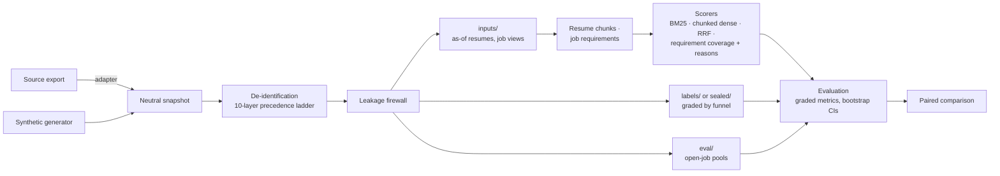

# matching-recommendation-algorithm

Candidate-centric job matching and recommendation: given one candidate, find the open jobs where
they are most likely to move forward, and explain why each one fits.

## Why this project

### Main scenario: one candidate, several fitting jobs

A recruiter sources a candidate. The system reads the candidate's background (experience, skills,
career trajectory, and the current preferences the recruiter records) and recommends **several**
suitable jobs from the ones currently open, not just one. The value is twofold: more successful
placements, and a stronger relationship with the candidate, who is offered more relevant
opportunities and comes to trust the recruiter.

### Core problem: information lost between the client side and the candidate side

In agency recruiting, most recruiters get job information from an account manager who works
with the client. Consultants who cover both sides are not the norm,
so requirements arrive second-hand and part of them is lost on the way:

- The job description may be an old template that was never updated.
- The client's real preferences often sit in internal notes and client feedback, or were never
  written down at all.
- Which candidates the client actually moved forward says more about the job than its text does.

A match score alone is therefore not enough. The system should also:

- work out a job's **effective requirements**, not just its written ones;
- **mark what is uncertain**, in the requirements and in the candidate's evidence;
- draft **clarifying questions for the account manager or client**, and **questions for the recruiter to check
  with the candidate**.

Today the repository covers the first layer: requirement-level matching splits each job into
must-haves, nice-to-haves and years of experience, looks for evidence in the resume, and states
plainly what is met and what is missing. Uncertainty flags and the two question lists are on the
[roadmap](docs/roadmap.md).

### What the system does not do

- It does not judge whether a resume is truthful. It only marks evidence that is thin, inconsistent,
  or worth checking.
- It does not replace the recruiter's decision. Every output is a suggestion with its evidence and
  confidence.
- It does not link candidates to outside personal information such as a personal GitHub or blog.

### Extension directions and Implications in the future

- **Internal mobility.** Recommend internal roles to current employees, drawing on HR records,
  performance, 360 feedback and project history. The core is already person-centred: a talent
  profile is "profile + evidence source", so this mostly means writing a new data adapter.
  Preconditions: employees are informed and consent, HR governance is in place, and the use of
  sensitive data has passed a compliance review.
- **Further work:** a company-level talent map, a supervised GNN compared against the text models,
  fine-tuning the embedding model, and a trial inside a real recruiting workflow.

## What makes it hard to do honestly

Using past hiring outcomes as evidence raises three problems that most matching demos skip:

- **Leakage.** A resume captured after a submission often already lists the job the candidate was
  placed in, and outcome fields sit next to the text. Evaluated without a guard, a model looks far
  better than it is.
- **Weak labels.** Nobody labels "good match". What exists is how far each process went: submitted,
  reviewed, interviewed, offered, hired. A process that ended is not proof of a poor fit.
- **People in the text.** Resumes and job notes are full of names and contacts. Models need the
  professional content and none of the people.

The repository runs end to end on a seeded synthetic dataset. No real data is included, and none is
needed to run anything here.

## What is inside



| Package | What it does | Docs |
|---|---|---|
| `matchrec.schema` | Neutral data model, source-adapter seam, configurable hiring funnels (L1–L4 graded relevance) | [schema](docs/schema.md), [funnels](docs/funnel.md) |
| `matchrec.synthetic` | Seeded generator: hidden fit, vocabulary mismatch, bilingual resumes, leakage traps, de-identification stress | [schema § synthetic](docs/schema.md#synthetic-data) |
| `matchrec.deid` | Span-level de-identification with one ordered decision function, local name detectors, human term decisions, audit and leak sampling | [de-identification](docs/deidentification.md) |
| `matchrec.matching` | Leakage firewall, as-of resume cut, candidate-level split, resume chunking, requirement-level matching with plain-language reasons, swappable encoders, evaluation, paired bootstrap comparison | [matching](docs/matching.md) |

## Quick start

Python 3.11+. The core uses only the standard library.

```bash
pip install -e ".[dev]"
```

```bash
export PYTHONPATH=src MATCHREC_DATA_DIR=data
```

```bash
python -m matchrec.synthetic.generate --out data/raw --candidates 1500 --jobs 300
```

```bash
python -m matchrec.deid.pipeline --snapshot data/raw --out data/deid --detector heuristic
```

```bash
python -m matchrec.matching.firewall --snapshot data/deid --role dev
```

```bash
python -m matchrec.matching.evaluate --build data/builds/synthetic-seed7__deid__dev --scorer bm25
```

```bash
python -m matchrec.matching.compare --build data/builds/synthetic-seed7__deid__dev --ref random
```

Dense and hybrid retrieval need `pip install -e ".[ml]"` and download a local encoder
(`BAAI/bge-m3` by default) on first use. De-identification with real text needs
`pip install -e ".[deid]"` and a spaCy model. Run the tests with `pytest`.

## Design decisions

**Funnels, not fixed stages.** A funnel lists the stages a source records and maps them to graded
relevance: L1 put forward, L2 employer review, L3 interview, L4 offer or hire. A staffing-agency
funnel, a direct-hire funnel and a source that only records "applied" and "hired" are all configuration.
Metrics are reported only for the levels a funnel can observe.

**Ended is unknown, not negative.** Labels are positive-unlabelled. Jobs nobody was submitted to are
unlabelled too, so every metric is a lower bound.

**A physical firewall.** One build writes model inputs, labels and evaluation pools to separate
directories. The model-side loader rejects any record carrying an outcome or identity field. Test
builds expose no labels to models at all.

**As-of everything.** A query is one candidate's submission episode, dated by its first submission.
The resume a model sees is the version bound to that submission, else the latest one captured before
it, else the latest one with later experience entries cut out. The job pool is the jobs open on that
date.

**Candidate-level split.** All of a candidate's applications sit on one side. The sealed test set is a
hashed candidate hold-out, stable across snapshots without any shared state.

**Chunks and requirements, not whole documents.** One vector per resume dilutes skills and truncates
long resumes. Resumes are split into experience entries and sections, each with its own vector.
Requirement-level matching goes one step further: the job is split into requirements, each is
matched against resume chunks, and the score is weighted coverage. Every score keeps its evidence,
so the system can say why a job is recommended.

**Swappable encoders.** The model is configuration. `BAAI/bge-m3` is the default for retrieval
(multilingual, strong Chinese–English alignment); `intfloat/multilingual-e5-large` is suggested for
short requirement-versus-evidence matching. Input conventions per model family live in one table. A
remote embeddings API can be plugged in for public data and is off by default.

**Paired comparisons.** Two scorers are compared on the same queries, with per-query differences
bootstrapped. A confidence interval that contains zero is reported as "cannot tell yet", not as
"equal".

**De-identification by precedence.** Contacts > known names > reference sections > citation authors >
resume header > human decisions > technical tokens > public lexicons > format rules > default mask.
One function decides every span, the same one used for audit. Only the uncertain span is masked,
never the whole document.

## Results on synthetic data

These numbers check that the pipeline works and that each component does what it claims. They are
not a measure of real-world performance: the generator defines the ground truth.

Development build, 1,500 synthetic candidates, de-identified first; mean with 95% bootstrap CI.

| Scorer | Recall@10 L3+ | Recall@10 L4 | NDCG@10 | MRR |
|---|---|---|---|---|
| Random | 0.19 | 0.20 | 0.09 | 0.14 |
| Popularity (other folds, before as-of) | 0.19 | 0.20 | 0.09 | 0.14 |
| BM25, bilingual | 0.80 | 0.82 | 0.27 | 0.25 |
| Dense, one vector per resume (bge-m3) | 0.64 | 0.65 | 0.22 | 0.23 |
| Dense, chunked, mean of top 3 | 0.72 | 0.75 | 0.25 | 0.24 |
| Dense, chunked, best chunk | 0.66 | 0.68 | 0.22 | 0.22 |
| Dense, chunked, recency-weighted | 0.65 | 0.70 | 0.22 | 0.22 |
| Hybrid, BM25 + whole-resume dense | 0.77 | 0.78 | 0.26 | 0.25 |
| Hybrid, BM25 + chunked dense | 0.79 | 0.81 | 0.26 | 0.25 |
| Requirement coverage, lexical evidence | 0.80 | 0.83 | 0.27 | 0.25 |
| Requirement coverage, + semantic evidence (multilingual-e5-large) | **0.81** | 0.85 | **0.27** | **0.25** |
| Requirement coverage, + semantic evidence (bge-m3) | **0.81** | **0.85** | **0.27** | **0.25** |

Means over 1,474 queries; 95% bootstrap intervals are in the generated reports and are about ±0.03 for
recall and ±0.01 for NDCG and MRR.

What the paired comparisons say:

- **Chunking is the largest single improvement to dense retrieval.** Against one vector per resume,
  chunked dense with top-3 averaging gains +0.08 Recall@10 at L3+, +0.10 at L4 and +0.02 NDCG@10, all
  with intervals excluding zero. Averaging the best three chunks beats taking only the best one: in this
  data a good fit means several relevant roles, not one.
- **Chunked hybrid closes the gap to BM25.** Whole-resume hybrid trails BM25 by about 0.04 Recall@10;
  chunked hybrid is indistinguishable from it on every metric.
- **Requirement coverage matches BM25 and explains itself.** Every score carries per-requirement
  evidence and a reason such as "Meets 3 of 4 required items (pandas, python, statistics); missing:
  a/b testing; about 7 years of experience vs 5+ asked." Semantic evidence from multilingual-e5-large
  adds a small but significant gain over lexical evidence alone (+0.005 NDCG@10, +0.007 MRR). Against
  BM25, all requirement variants are statistically indistinguishable, with the semantic ones ahead on
  point estimates.
- **Semantic evidence needs hubness correction.** Raw cosine similarity let short, generic chunks act
  as evidence for almost anything (the first run cited an education line as evidence for A/B testing).
  CSLS-style correction cut evidence placed in education lines from 101 to 18 among 4,422 explanations,
  without hurting ranking quality.
- **Popularity is no better than random,** as intended: in this generator, popularity carries no
  information about fit.

Why BM25 stays strong here: the synthetic job ads and resumes are short and templated, and the hidden
fit is driven largely by overlap with a small set of skill terms, which is exactly what BM25 weights.
This is a property of the generator, not a general result about lexical versus semantic retrieval; it
is reported as measured rather than tuned away.

De-identification on the same data: no candidate name, contact or job-related person visible after
redaction; 0 of the generator's third-party names leaked with the heuristic detector, which recognises
exactly the name patterns the generator writes, so this verifies the mechanism, not a real-world leak
rate. Over 97% of skill mentions stay readable.

## Data and privacy

- No data enters this repository. `.gitignore` blocks snapshots, builds, caches, decision files and
  audit outputs.
- Real data reaches the pipeline only through a source adapter that maps an export into the neutral
  schema. The field names in this repository are the project's own vocabulary; an adapter's mapping
  is specific to its source and changes with it. Adapters for real systems stay outside the repository.
- Every model and detector runs locally.

## Roadmap

Explicit feedback (a rated gold set and recruiter feedback on recommendations), stage-transition priors
and score calibration for sources without full funnels, a cross-encoder scoring each
requirement–evidence pair, a graph model on the candidate–job–organization graph, and a local LLM
interface. See [docs/roadmap.md](docs/roadmap.md).

## Layout

```
src/matchrec/
  schema/      model.py, funnel.py, adapter.py
  synthetic/   generate.py, vocab.py
  deid/        ladder.py, redactor.py, detectors.py, citations.py, decisions.py, audit.py, pipeline.py, ...
  matching/    firewall.py, labels.py, asof.py, split.py, inputs.py, chunks.py, requirements.py, skills.py,
               encoders.py, text.py, retrieval.py, evaluate.py, compare.py
tests/         schema, funnel, de-identification, chunks and requirements, end-to-end pipeline
docs/          schema, funnel, matching, de-identification, roadmap
examples/      term_decisions.example.json
```

## License

MIT. See [LICENSE](LICENSE).
